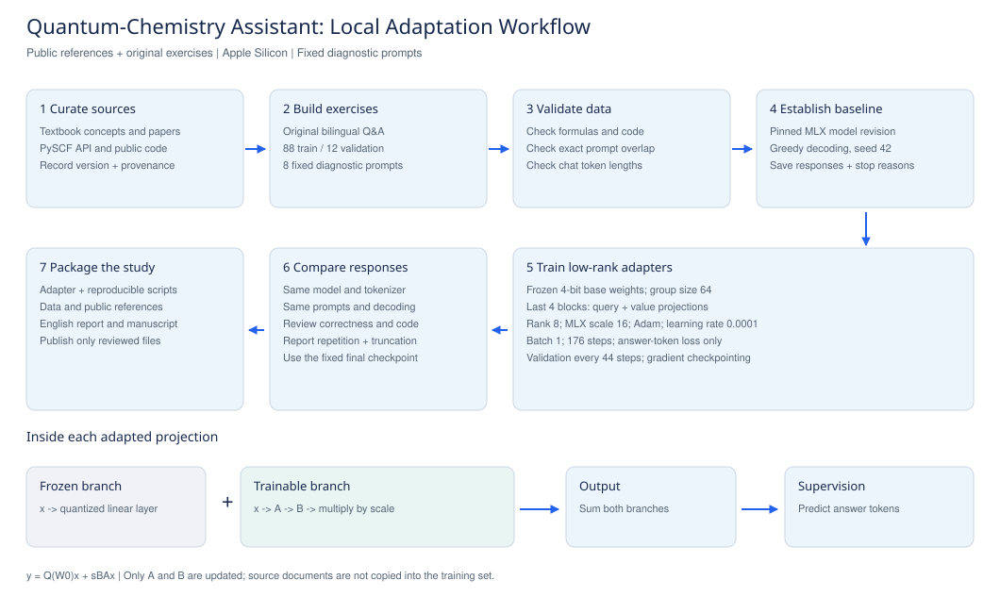

# Quantum-Chemistry Assistant

A small, reproducible experiment in adapting a 1.5B instruction model to quantum-chemistry explanations, algorithms, and code review on Apple Silicon.

**Status:** two local MLX experiments completed on October 23, 2026. Both final adapters and raw before/after responses are included. The first pilot scored 0/8 strict passes before and after training; the expanded follow-up scored 0/6 before and after on a different diagnostic set. These models are experimental and have not achieved reliable quantum-chemistry reasoning.



## Scope

The dataset contains original bilingual exercises about spin, Hartree-Fock, CI, CASSCF, orbital rotations, numerical checks, and public PySCF interfaces. It uses public references and standard textbook concepts. It does not redistribute source books or papers. Source records are in `sources.json`; example-level attribution is in `data/provenance.json`.

This is a pilot, not a validated quantum-chemistry expert. Generated derivations and code require independent checking.

## Experiment

| Item | Fixed setting |
|---|---|
| Base model | `mlx-community/Qwen2.5-Coder-1.5B-Instruct-4bit` |
| Model revision | `b3252a2f97102b1fb1571fec2c9b27219a8536be` |
| Dataset | 88 training / 12 validation examples |
| Diagnostic set | 8 fixed prompts, separate from training |
| Trainable modules | Query and value projections in the last 4 blocks |
| LoRA rank / MLX scale | 8 / 16 |
| Optimizer / learning rate | Adam / 0.0001 |
| Batch size / steps | 1 / 176 |
| Sequence limit | 1024 tokens |
| Loss | Assistant answer tokens only |
| Memory control | Gradient checkpointing |
| Checkpoint rule | Fixed final step, not selected on diagnostic answers |
| Before/after decoding | Greedy, seed 42, 512 output tokens |

The model uses MLX groupwise 4-bit weights, not the original QLoRA paper's exact NF4 implementation. MLX `scale` multiplies the low-rank update directly; it is not an `alpha` field automatically divided by rank.

`scripts/train_mlx.py` supplies an explicit loss to the MLX-LM training and validation routines. For an answer beginning at token index `offset` in a sequence of length `L`, only targets with `offset <= index < L` contribute. Prompt and padding targets are excluded, and the boundary mask is checked numerically.

## Run

Use a native Apple Silicon terminal with Metal access. A restricted or headless execution environment may not expose the GPU.

```bash
python3 -m venv .venv
source .venv/bin/activate
python -m pip install -r requirements.lock.txt
python scripts/build_dataset.py
python scripts/validate_data.py
python scripts/check_numerics.py
python scripts/run_pipeline.py --model models/base --run-dir runs/pilot-01
```

The pipeline pins the base-model revision, checks chat token lengths, evaluates the unadapted model, trains the adapter, and evaluates the adapted model using the same inference settings. It writes `status.json`, data hashes, logs, model responses, and adapter weights under the run directory. It never uploads files automatically.

Use a new run directory for every experiment. An existing adapter is not overwritten. If a process fails, inspect the saved status and log before restarting.

To separate downloading from training, first run `python scripts/download_model.py --output models/base`. A successful download writes a manifest and verifies the pinned files. Then use `python scripts/run_pipeline.py --model models/base --run-dir runs/pilot-01 --offline`. Offline mode requires a complete verified checkpoint and never falls back to a network download.

A hostname-resolution error during downloading means the model has not been obtained. A terminal message such as “process completed” only reports that the terminal process exited. Successful training and evaluation are recorded as `"status": "completed"` in the run's `status.json`.

## Read the outputs

- `before.jsonl` and `after.jsonl`: raw diagnostic responses, stopping reasons, token counts, timing and peak-memory measurements.
- `training.log`: actual training and validation loss reports.
- `adapters/adapters.safetensors`: low-rank weights after successful training.
- `run_metadata.json`: pinned model, software versions and input hashes.
- `data_checks.json`: data counts and maximum chat lengths.

Compare responses with the rubrics in `evaluation/holdout.jsonl`. Do not score scientific correctness by keyword presence. Distinguish a wrong answer, an incomplete answer and generation stopped by the token limit.

The diagnostic prompts were inspected during development, and data themes overlap with them. They are a transparent case study, not a blind generalization benchmark. Several training and validation exercises are parameterized variants. A larger, independently reviewed, source-disjoint test suite is needed before claiming broad reliability.

## Observed pilot results

The run completed all 176 steps in 130.34 seconds for the training stage. Its 155,648 trainable parameters occupy a 624,302-byte adapter file. The first and final reported validation losses were 3.870 and 2.427. Strict scientific correctness remained 0/8 before and after adaptation; token-limit truncations decreased from 6/8 to 2/8. Shorter answers and lower loss did not establish reliable reasoning or valid scientific code.

The review is unblinded and AI-assisted, with no independent expert adjudication. See [the measured metrics](results/pilot-01/metrics.json), [case-level review](results/pilot-01/review.json), and raw responses in `results/pilot-01/`. Training peak memory was not recorded; inference memory reports must not be relabeled as training memory.

Load the included adapter with the same pinned MLX base model. The `adapters/adapter_config.json` paths are portable replacements of machine-local paths; training settings and weight bytes are unchanged.

```bash
python -m mlx_lm generate --model models/base --adapter-path adapters --prompt "Explain the AO overlap metric in RHF."
```

## Workflow and manuscript

See [the detailed procedure](docs/workflow.md), the [vector workflow figure](figures/workflow.pdf), the [paper PDF](paper/main.pdf), and its [LaTeX source](paper/main.tex). The manuscript reports both completed experiments, their negative diagnostic results, and their limitations. It has not been submitted to a preprint server.

## Deployment

The adapter was merged into the pinned base, converted to GGUF, quantized to Q4_K_M, and imported into Ollama 0.40.6 as `quantum-chemistry-pilot:1.5b`. A local generation call completed successfully, but its answer to a basic spin question was scientifically incorrect. This verifies loading and inference only. The model is experimental and should not supply unchecked scientific conclusions.

```bash
ollama run quantum-chemistry-pilot:1.5b
```

This command works on the machine where the import was performed. On another machine, follow [the export procedure](docs/deployment.md). The repository includes both small trained adapters and the conversion recipe; the approximately 986 MB merged GGUF is not stored in Git. Export hashes and the separate raw smoke response are in `results/deployment/`. Further quantization can change model behavior; the matched MLX scores are not deployment scores.

The follow-up is also installed locally as `quantum-chemistry-followup:1.5b`; run it with `ollama run quantum-chemistry-followup:1.5b`. Its separate smoke generation completed but again failed the scientific question and repeated until the output limit. See `results/deployment-followup/`; it is an experimental export, not a validated specialist.

## Expanded experiment

The [expanded follow-up](docs/followup.md) completed with 144 training and 20 validation examples, 12 executed code cases, and six new diagnostic prompts. It used 576 steps and 449.09 seconds of training. Validation loss decreased from 3.388 to 2.466, but strict passes stayed at 0/6; truncations fell from 3/6 to 1/6. Its adapter is in `experiments/followup/adapters/` and audited responses are in `results/followup-01/`. The dataset and training duration both changed, and the diagnostic sets differ between experiments. These results do not establish improved scientific reliability.

## References

- Helgaker, Jørgensen and Olsen. *Molecular Electronic-Structure Theory*. Wiley, 2000.
- [PySCF documentation](https://pyscf.org/user/mcscf.html).
- [Qwen2.5-Coder technical report](https://arxiv.org/abs/2409.12186).
- [LoRA](https://arxiv.org/abs/2106.09685) and [QLoRA](https://arxiv.org/abs/2305.14314).
- [MLX-LM training documentation](https://github.com/ml-explore/mlx-lm/blob/main/mlx_lm/LORA.md).

The public base model retains its Apache-2.0 license. References remain under their respective licenses; this repository contains original exercises rather than copies of those works.
